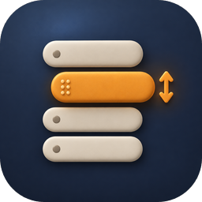

# sidebar-order: свой порядок в списке сессий



Плагин для [Agents Hub](https://github.com/flagman/agents-hub-core). Строку в левом списке сессий можно перетащить
внутри её группы: «Специалисты», «Направления», «Исполнители», «Спят или упали», форки агента. Мышью строку просто
тянут. На телефоне палец держат на строке, пока она не поднимется, и ведут. Короткий свайп остаётся прокруткой.

Порядок хранит браузер (localStorage), у каждого браузера он свой. Новая сессия встаёт в конец своей группы.
Сбросить порядок можно в «Настройки» → «Порядок в списке».

Ядро хаба не меняется. Список строит хаб, а плагин переставляет его строки в месте `sidebar.footer`: хаб рисует
это место сразу после списка, так что перестановка успевает до отрисовки. Строку плагин узнаёт по своей скрытой
метке в месте `sidebar.session`.

## Установка

«Настройки» → «Плагины» → поставить из маркетплейса. Без маркетплейса — строкой в `hub.json`:

```json
"extensions": {"sidebar-order": {"path": "~/hub-plugin-sidebar-order", "web": "web/main.js"}}
```

Процесса у плагина нет, только код страницы. Нужен API плагинов хаба 1.7 или новее.
